<div align="center">

<picture>
  <source media="(prefers-color-scheme: dark)" srcset="docs/brand/logo_dark.png" />
  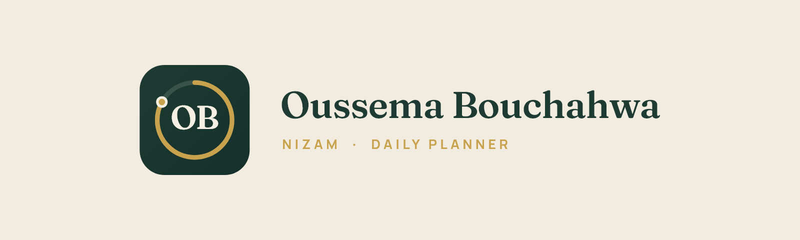
</picture>

# Nizam

**One daily planner for a Tunisian student's real life: classes, prayer, study, training, food and work.**


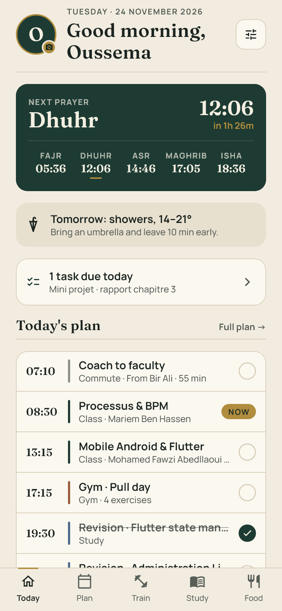&nbsp;
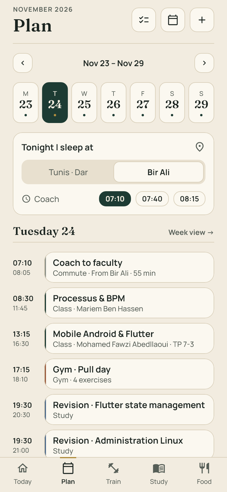&nbsp;
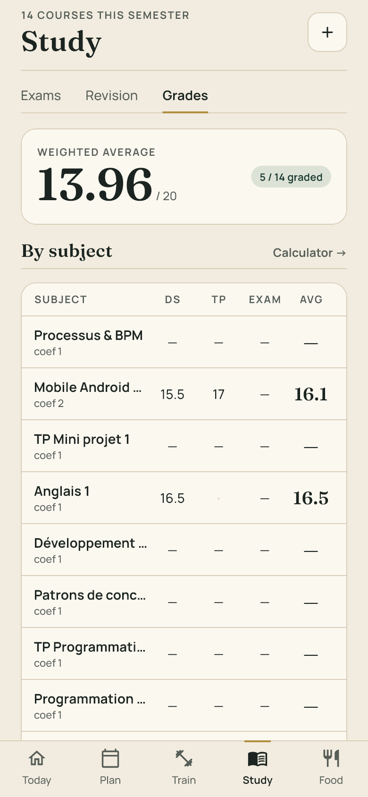&nbsp;
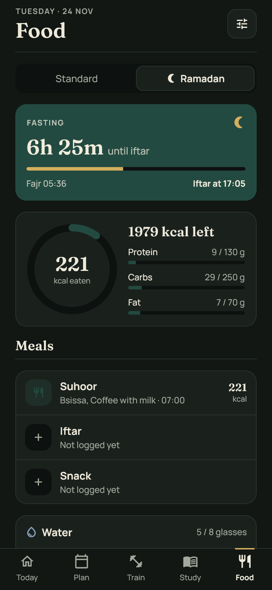

</div>

---

## Why Nizam?

A student's day here is spread over many places: the faculty timetable (a PDF or a JSON export), prayer times, the coach schedule when sleeping far from the faculty, exam dates in a group chat, marks in a notebook, a training plan, what to eat.

Nizam puts all of it in **one day view** and works out the connections for you:

- your **real timetable** is loaded from the faculty export;
- **prayer times are calculated on the phone**, so they work with no connection;
- an event that overlaps a prayer is **flagged, with a one-tap fix**;
- ticking a study session **counts towards your revision goal**;
- your **average updates** as soon as you enter a mark, and the calculator tells you what you need in the exam.

Everything you enter stays on your phone.

## Table of contents

- [Screens](#screens)
- [How it works](#how-it-works)
- [Architecture](#architecture)
- [Design system and responsive layout](#design-system-and-responsive-layout)
- [Data and privacy](#data-and-privacy)
- [Getting started](#getting-started)
- [Testing](#testing)
- [Project structure](#project-structure)
- [Roadmap](#roadmap)

## Screens

### Today: the whole day at a glance

<table>
  <tr>
    <td width="33%"></td>
    <td width="33%">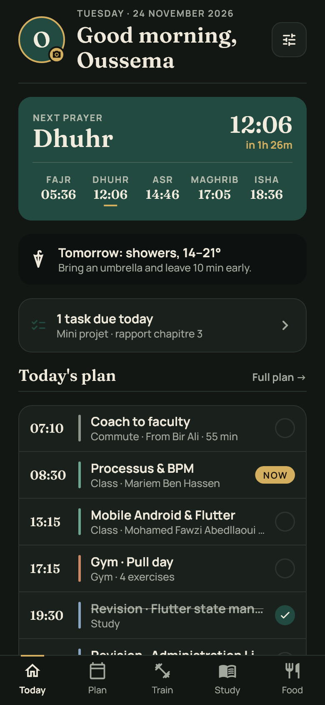</td>
    <td valign="top">

- **Next prayer** with a live countdown and the five times of the day
- **Tomorrow's weather** with practical advice (umbrella, heat, cold morning)
- **Tasks due today**, overdue ones in red
- **Today's plan**: classes, coach, gym, study sessions, with a brass **NOW** marker
- Tick an item when it is done; tap it to open it
- Your **profile photo** at the top (gallery or camera)
- Light and dark themes share the same tokens

</td>
  </tr>
</table>

### Plan, timetable and tasks

<table>
  <tr>
    <td width="33%"></td>
    <td width="33%">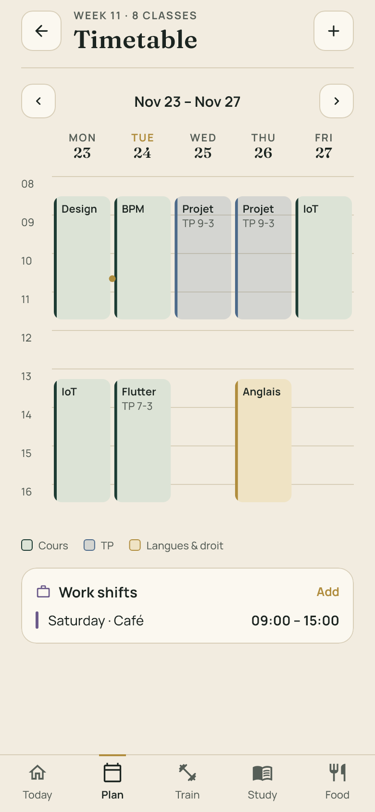</td>
    <td width="33%">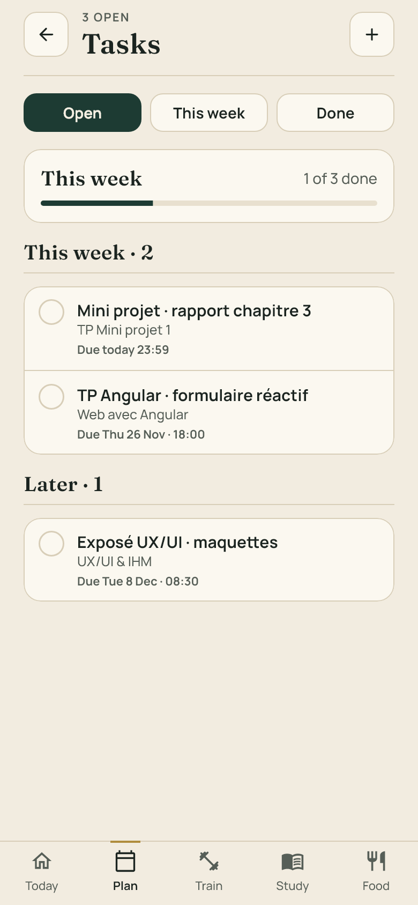</td>
  </tr>
  <tr>
    <td valign="top"><b>Plan.</b> Browse any week. Each day is built from classes, exams, gym days, work shifts and your own events. Say where you sleep tonight: from the far place, the coach is added on class days.</td>
    <td valign="top"><b>Timetable.</b> The faculty export as a weekly grid, with the semester week number. Colours separate lectures, practical work and transversal modules. Tap a class for the professor and room.</td>
    <td valign="top"><b>Tasks.</b> Reports, projects and homework with deadlines, grouped into overdue, this week and later, with weekly progress.</td>
  </tr>
</table>

### Add an event, with prayer-conflict detection

<table>
  <tr>
    <td width="33%">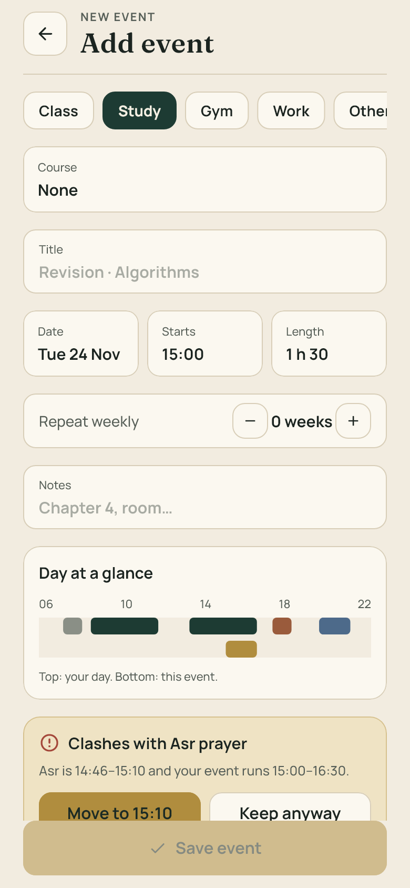</td>
    <td valign="top">

When an event overlaps a prayer, Nizam says so and offers to **move it right after the prayer** (or keep it anyway).

- Category, linked course, date, start time and length
- **Repeat weekly** for a number of weeks
- **Day at a glance**: your day on top, the new event below, so clashes are visible before saving
- Events you create can be edited or deleted later

</td>
  </tr>
</table>

### Study: exams, revision and grades

<table>
  <tr>
    <td width="25%">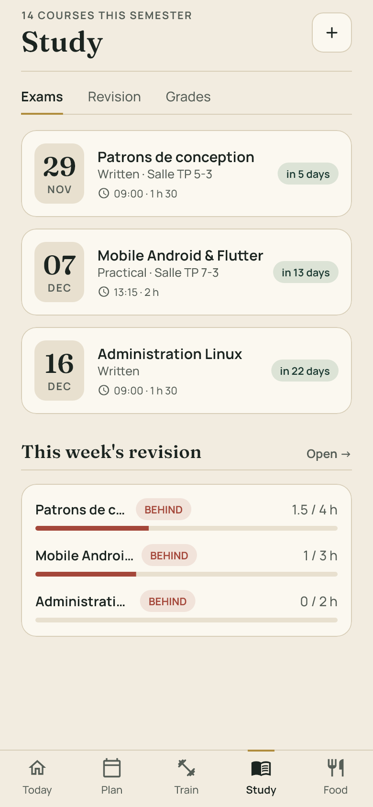</td>
    <td width="25%">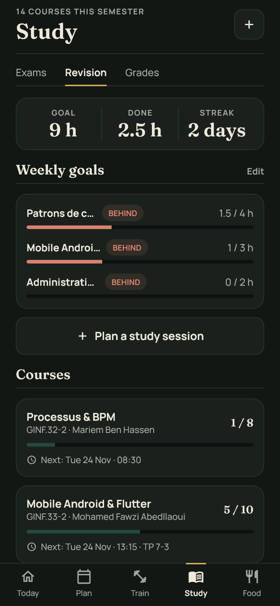</td>
    <td width="25%"></td>
    <td width="25%">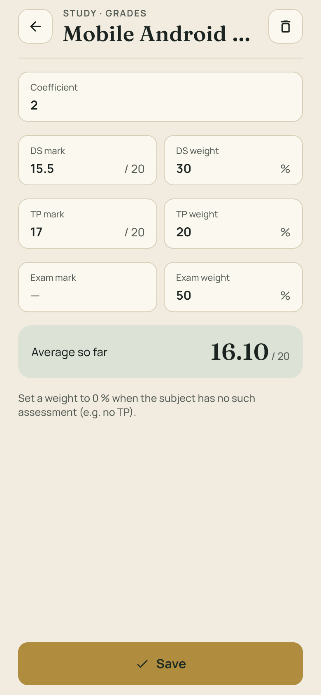</td>
  </tr>
  <tr>
    <td valign="top"><b>Exams</b> with countdowns. They also appear in the plan and send a reminder the evening before and an hour before.</td>
    <td valign="top"><b>Revision.</b> Set weekly hours per course. Study sessions you tick fill the goal; courses falling behind are flagged. Streak of study days.</td>
    <td valign="top"><b>Grades.</b> One row per course of the timetable. The weighted average uses each subject's coefficient.</td>
    <td valign="top"><b>Per subject:</b> DS, TP and exam marks, their weights and the coefficient, with a live preview of the average.</td>
  </tr>
</table>

The **grade calculator** answers *"what do I need in the exam to reach 12?"* using the marks you already have:

```
needed = (target × Σ weights − Σ known weight × mark) ÷ Σ missing weights
```

### Training

<table>
  <tr>
    <td width="33%">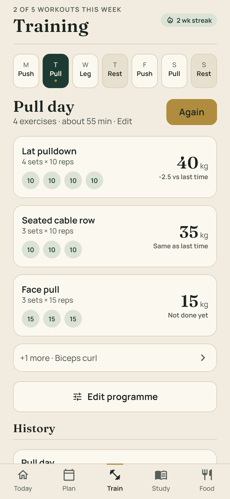</td>
    <td width="33%">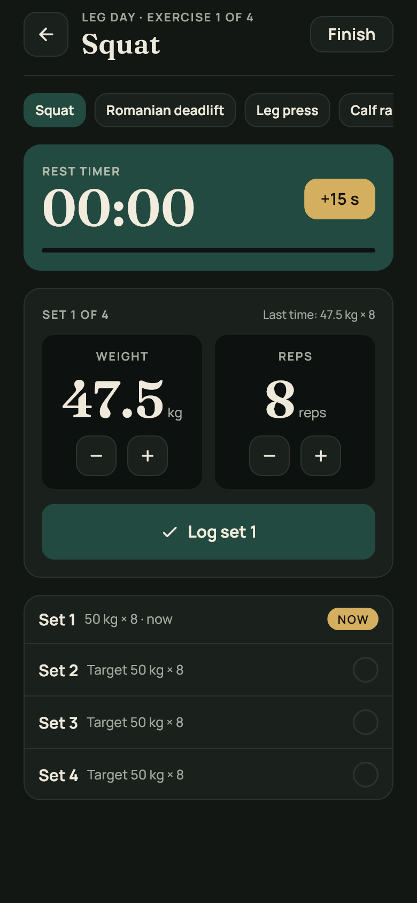</td>
    <td valign="top">

- **Your programme**: a workout for each weekday, rest days, usual gym time. Gym days appear in the plan.
- **Workouts and exercises** you can create, edit and reorder
- **Workout log** with weight and reps steppers, a rest timer and undo
- **History**: sets and total volume per session; each exercise shows *"vs last time"*
- **Streak** of weeks with at least one workout

</td>
  </tr>
</table>

### Food, including Ramadan

<table>
  <tr>
    <td width="33%">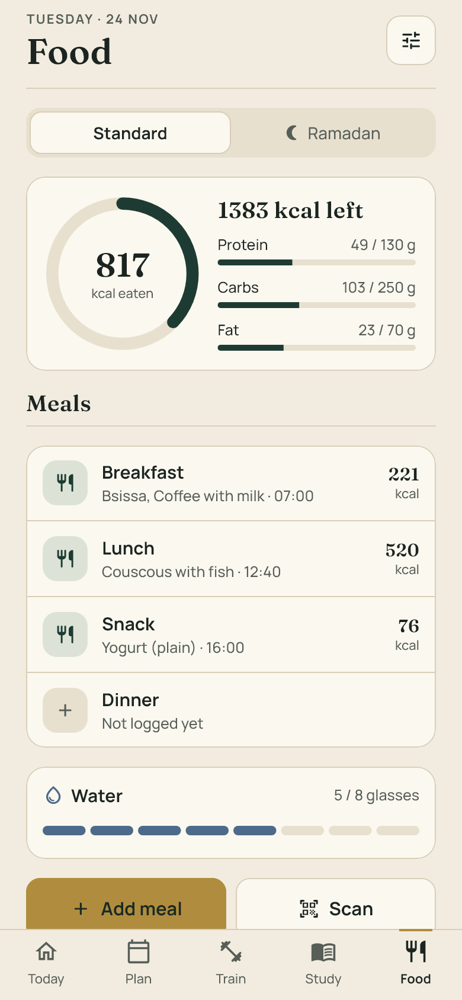</td>
    <td width="33%"></td>
    <td valign="top">

- **Daily diary** with calories and macros against your goals
- **34 common Tunisian foods** (couscous, lablabi, brik, bsissa…) plus your own
- **Barcode scanner**: the product is looked up in Open Food Facts and saved for next time
- **Water** tracker
- **Ramadan mode**: suhoor and iftar meals and a countdown to iftar, computed from the day's real Fajr and Maghrib

</td>
  </tr>
</table>

### Onboarding and settings

<table>
  <tr>
    <td width="33%">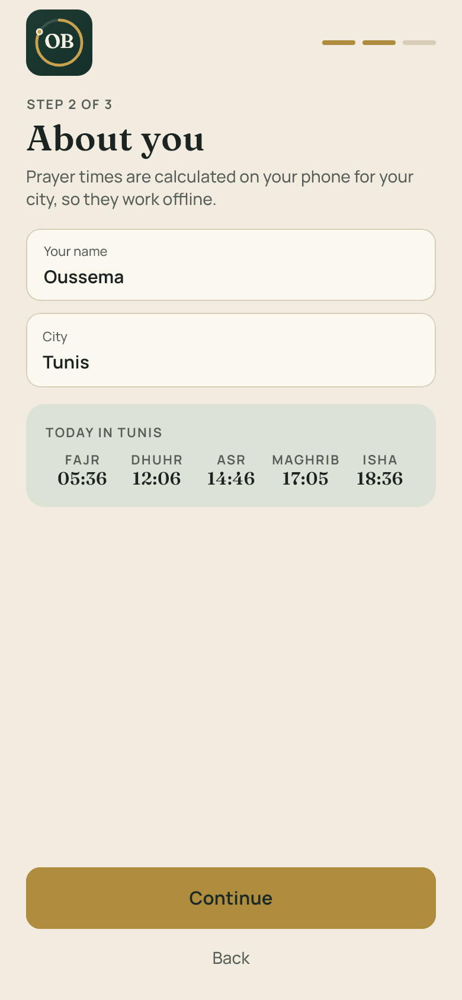</td>
    <td width="33%">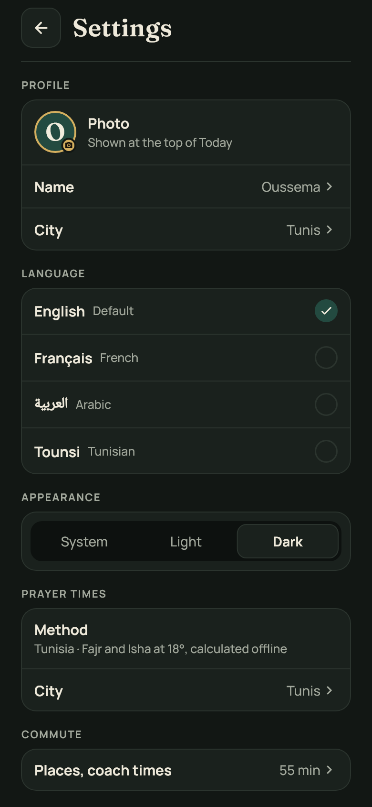</td>
    <td valign="top">

**Three-step onboarding:** language, then name and city (with that city's prayer times as a preview), then a summary of the imported timetable.

**Settings:** profile photo, name and city, language (English, Français, العربية, Tounsi) with right-to-left layout, theme, commute places and coach times, notification toggles.

</td>
  </tr>
</table>

## How it works

### Prayer times, calculated offline

Times come from a **solar-position calculation** (the PrayTimes.org method) using the Tunisian parameters: Fajr and Isha at 18° below the horizon, and Asr when a shadow equals its object. They cover 25 Tunisian cities. Tests compare them with the [Aladhan API](https://aladhan.com/prayer-times-api) (method 18, Tunisia) for Tunis and Sfax in summer and winter: all within **one minute**. Friday's Dhuhr is shown as Jumu'a.

### One day, many sources

No item is stored twice. For any day, the plan asks each source for its items and merges them:

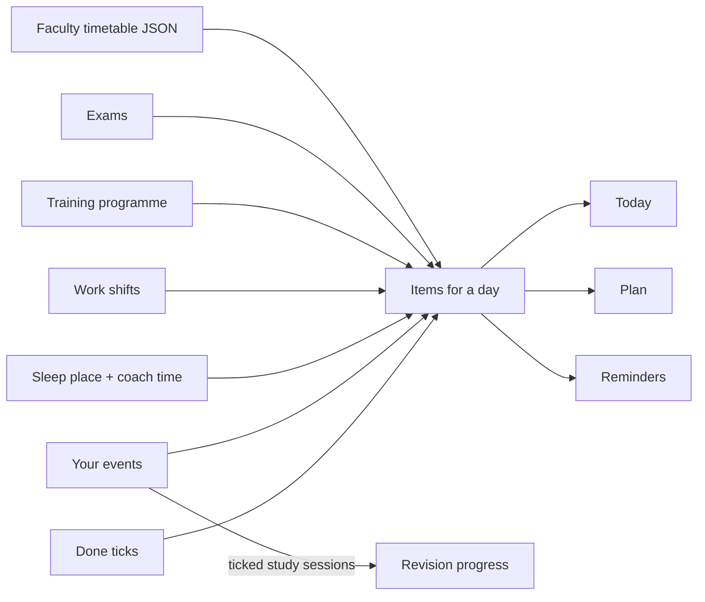

Changing your training programme, a work shift or where you sleep updates every day at once.

### Reminders

Notifications are recomputed from the same data and rescheduled only when they change:

| Reminder | When |
| --- | --- |
| Prayer | At each prayer time |
| Coach | 20 minutes before the departure |
| Exam | The evening before at 20:00, and one hour before |

## Architecture

Feature-first, three layers per feature. Screens only compose widgets; rules live in controllers and pure Dart classes that are easy to test.

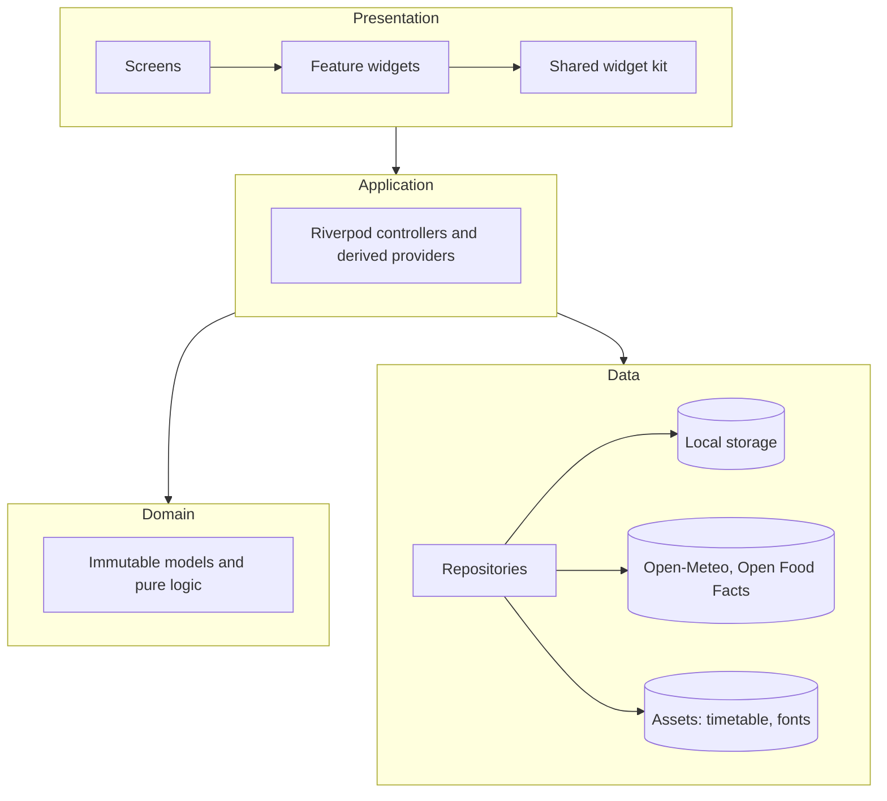

| Layer | Contents | Example |
| --- | --- | --- |
| `domain/` | Immutable models, pure logic | `GradeMath.neededMark`, `PrayerCalculator` |
| `data/` | Repositories behind interfaces | `TimetableRepository`, `OpenFoodFacts` |
| `application/` | State and rules | `itemsForDayProvider`, `WorkoutSessionController` |
| `presentation/` | Screens, one widget per file | `TodayScreen`, `ExamFormScreen` |

**Conventions**

- **One base class for every editable list.** Exams, events, tasks, workouts, meals and shifts extend `StoredListController`, which handles add, edit, delete and saving. A new list needs only a key and a `fromJson`.
- **One form kit.** `FormPage`, text, number, date, time and picker fields and a stepper, so every form looks and behaves the same.
- **Small files.** A screen lists its blocks and nothing else; long screens are split into widgets.
- **Navigation** with `go_router`: one stack per tab, route names in `core/router/routes.dart`.

## Design system and responsive layout

All styling comes from tokens taken from the Figma variables. Screens never hard-code a colour or a font size.

```dart
context.colors.brand   // colour tokens, light and dark
context.text.title     // Fraunces for titles and numbers, Manrope for interface text
AppSpacing.gutter      // spacing, radius and size tokens
```

The palette follows a **60 / 30 / 10 rule**: parchment backgrounds, bottle green brand, and brass reserved for the main action, the NOW marker and the active tab.

Nothing is sized with a raw constant:

```dart
context.wp(0.33)   // 33 % of the screen width (the calorie ring)
context.hp(0.32)   // 32 % of the screen height (the camera preview)
context.dp(22)     // a Figma measurement (390-wide frame) scaled to this screen
```

Typography is scaled once for the whole app. A test renders **every screen at 320, 390 and 430 px wide** and fails on any overflow.

## Data and privacy

- **Everything you enter stays on your phone** (local JSON storage). There is no account and no server.
- Only two features use the network, and both keep working without it:

| Service | Used for | What is sent |
| --- | --- | --- |
| [Open-Meteo](https://open-meteo.com) | Tomorrow's weather | The chosen city's public coordinates |
| [Open Food Facts](https://world.openfoodfacts.org) | Barcode lookup | The barcode number |

- Offline, Today shows a notice, the last weather forecast is reused, and scanned foods stay available.
- Fonts are bundled (`assets/fonts`, SIL Open Font License), so the design looks right without a connection.

## Getting started

**Requirements:** Flutter 3.47 or newer. For Android, the Android SDK; for iOS, a Mac with Xcode.

```bash
git clone https://github.com/OussEmabouchahwa/life-app.git
cd life-app
flutter pub get
flutter run
```

**Use your own timetable.** Replace `assets/data/timetable.json` with your faculty export. Each entry looks like this:

```json
{
  "jour": "Lundi",
  "date": "14/09/2026",
  "creneau": "S1 : 8:30 à 11:45",
  "ecue": "GINF.31-1 Introduction à la programmation avancée",
  "professeur": "…",
  "salle": "-"
}
```

Short names for the timetable cells are set per course code in `lib/features/timetable/data/course_labels.dart`. Entries that cannot be read are skipped instead of breaking the import.

## Testing

```bash
flutter analyze
flutter test
```

| Suite | What it checks |
| --- | --- |
| `prayer_calculator_test` | Times match Aladhan within one minute, Tunis and Sfax, summer and winter |
| `timetable_parser_test` | All 110 entries of the export, rooms, session types, broken entries skipped |
| `grade_math_test` | Weighted averages, needed exam mark, weights of zero |
| `features_logic_test` | Weather advice, barcode parsing, Ramadan phases, reminders, revision hours, task groups |
| `plan_logic_test` | Prayer conflicts, weekly repeats, workout logging and history |
| `screens_layout_test` | Every screen at three phone widths with no layout error |
| `onboarding_flow_test` | A fresh install goes through the three steps and lands on Today |

**Regenerate the screenshots** in this README (rendered from the real app, with sample data):

```bash
flutter test tool/screenshots/generate_screenshots_test.dart
```

## Project structure

```
lib/
├── app/                    App widget (theme, locale, RTL) and router
├── core/
│   ├── theme/              Design tokens: colours, text styles, dimensions, icons
│   ├── responsive/         Screen-relative sizing
│   ├── storage/            Local JSON storage and StoredListController
│   ├── widgets/            Shared widget kit
│   │   └── forms/          Form page, fields, pickers, stepper
│   ├── providers/          Clock, connectivity
│   └── ui.dart             Single import for UI code
├── shared/models/          Plan items and categories
└── features/
    ├── today/              Day overview, weather, offline notice
    ├── plan/               Day builder, events, tasks, work shifts, commute
    ├── timetable/          Faculty timetable import and grid
    ├── prayers/            Offline calculator, cities
    ├── study/              Exams, grades, revision, calculator
    ├── training/           Programme, workouts, log, history
    ├── food/               Diary, foods, scanner, Ramadan, water
    ├── notifications/      Reminders
    ├── settings/           Preferences, profile photo, commute
    ├── onboarding/         Three-step setup
    └── shell/              Tab bar
assets/
├── branding/               App icon sources (rendered from the logo widget)
├── data/timetable.json     Faculty export
└── fonts/                  Fraunces, Manrope, Noto Naskh Arabic
docs/screenshots/           README images
docs/brand/                 Logo images
tool/screenshots/           Screenshot generator
tool/branding/              Logo and icon generator
```

## Tech stack

| Package | Role |
| --- | --- |
| `flutter_riverpod` | State management |
| `go_router` | Navigation |
| `shared_preferences` | Local storage |
| `http` | Weather and product lookup |
| `mobile_scanner` | Barcode scanning |
| `image_picker` | Profile photo |
| `flutter_local_notifications`, `timezone`, `flutter_timezone` | Reminders |
| `connectivity_plus` | Offline notice |
| `intl`, `flutter_localizations` | Dates, numbers, right-to-left layout |

## Roadmap

- [x] Real timetable, offline prayer times, live weather
- [x] Forms and local storage for exams, grades, revision, training, events, tasks, shifts and meals
- [x] Tasks, Ramadan mode, barcode scanner, offline notice, onboarding, reminders, profile photo
- [ ] **Translations**: the interface text is in English. Choosing Arabic already switches the layout to right-to-left.
- [ ] **Home-screen widgets** (needs native Android and iOS widget code)
- [ ] **Backup and sync** between devices

## Brand

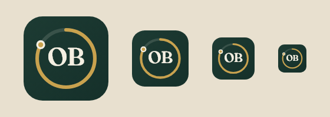

The logo is the **OB** monogram (Oussema Bouchahwa) inside a brass ring: a day dial filling up, ending on the app's NOW dot. It is drawn in code (`lib/core/widgets/brand`), so it stays sharp at any size and is reused in the app (onboarding, Settings). To change it, edit the widget and regenerate the images and launcher icons:

```bash
flutter test tool/branding/generate_branding_test.dart
dart run flutter_launcher_icons
```

## Credits

- Logo and app: Oussema Bouchahwa
- Design: *Daily Life App – Personal Planner* (Figma)
- Fonts: [Fraunces](https://fonts.google.com/specimen/Fraunces), [Manrope](https://fonts.google.com/specimen/Manrope), [Noto Naskh Arabic](https://fonts.google.com/noto/specimen/Noto+Naskh+Arabic), SIL Open Font License
- Data: [Open-Meteo](https://open-meteo.com), [Open Food Facts](https://world.openfoodfacts.org) (ODbL); prayer times checked against [Aladhan](https://aladhan.com)
